# Лабораторная работа №1. Построение и анализ регрессионных зависимостей

**Выполнили:** Сокол А.А., Галкин М.К., Спесивцев Я.М.
**Группа:** А-02-24  **Бригада:** 9

---

## Общие сведения

Работа выполнена на языке **Python 3** в **Jupyter Notebook**. Основные библиотеки: `pandas` (таблицы данных), `numpy` (математика), `matplotlib` и `seaborn` (графики), `scipy` (статистика: критерий Колмогорова–Смирнова, статистика Дурбина–Уотсона), `sklearn` (линейная регрессия, предсказание, R²), `pingouin` (частные корреляции).

В работе рассмотрено **пять наборов данных**:

1. **Iris** — размеры цветов (4 числовых признака), цель — построить регрессию для ширины чашелистика.
2. **Рост–Вес–Возраст–Позиция** (бейсболисты, 115 строк) — цель — предсказать вес по росту, возрасту и позиции.
3. **Barotrop.csv** — координаты (2 признака) — корреляционный анализ.
4. **Chemical_process.csv** — параметры химического процесса (5 признаков) — корреляционный анализ.
5. **Factor.csv** — 10 факторов — корреляционный анализ.

Все скрипты, соответствующие ноутбукам (`Iris.py`, `HW.py`, `Additional.py`), сохраняют полученные графики в каталог `pics/`. Все картинки приведены ниже.

**Порог значимости** для всех статистических тестов — α = 0.05.

---

## Датасет 1. Iris (Irisdat.csv)

**Что это:** 150 измерений четырёх числовых признаков цветка: `SEPALLEN` (длина чашелистика), `SEPALWID` (ширина чашелистика), `PETALLEN` (длина лепестка), `PETALWID` (ширина лепестка). Целевая переменная — `PETALWID`.

### 1. Диаграмма Тьюки (boxplot) и размах

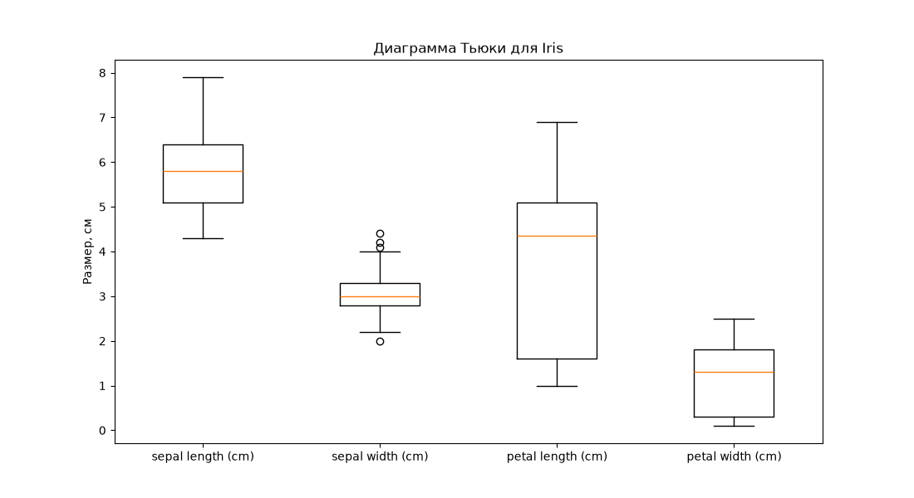

Все признаки распределены в узком диапазоне примерно **5.8–7.9**, то есть данные однородны по масштабу. Видны выбросы (точки за «усами») — их подробнее разбираем в разделе про выбросы.

### 2. Парные корреляции (тепловая карта)

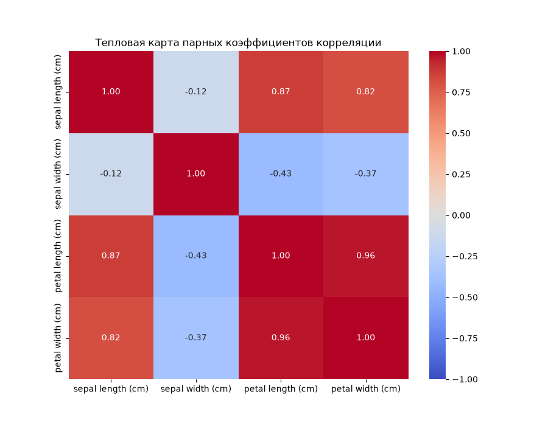

| Признак | SEPALLEN | SEPALWID | PETALLEN | PETALWID |
|---|---|---|---|---|
| **SEPALLEN** | 1 | −0.109 | 0.872 | 0.818 |
| **SEPALWID** | −0.109 | 1 | −0.428 | −0.366 |
| **PETALLEN** | 0.872 | −0.428 | 1 | **0.963** |
| **PETALWID** | 0.818 | −0.366 | 0.963 | 1 |

Самая сильная связь — **PETALLEN и PETALWID (r ≈ 0.96)**: длинные лепестки почти всегда широкие. Длина чашелистика тоже хорошо связана с лепестками (0.82–0.87). Ширина чашелистика (`SEPALWID`) слабо связана с остальными (|r| ≤ 0.43).

### 3. Частные корреляции

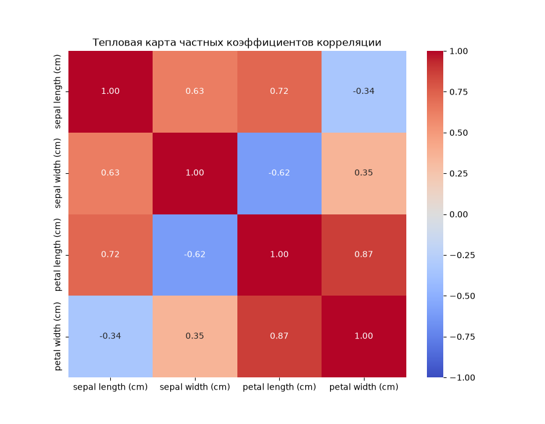

Частная корреляция — это связь двух признаков **после того, как влияние остальных признаков «вычтено»**. Сравнение с парной картой:

- PETALLEN ↔ PETALWID: парная **0.963** → частная **0.571**. Большая часть связи между лепестками «заимствована» через общую связь с чашелистиками; собственная связь заметно меньше, но всё ещё сильная.
- Связь `SEPALWID` с лепестками остаётся слабой.

**Вывод:** часть парных корреляций — «ложная» (появляется из-за третьей переменной), поэтому для регрессии важнее частные значения.

### 4. Критерий Колмогорова–Смирнова (нормальность признаков)

| Признак | D | p-value | Вывод |
|---|---|---|---|
| sepal length | 0.0887 | 0.1781 | нормальный |
| sepal width | 0.1057 | 0.0652 | нормальный |
| petal length | 0.1982 | 0.0000 | **ненормальный** |
| petal width | 0.1728 | 0.0002 | **ненормальный** |

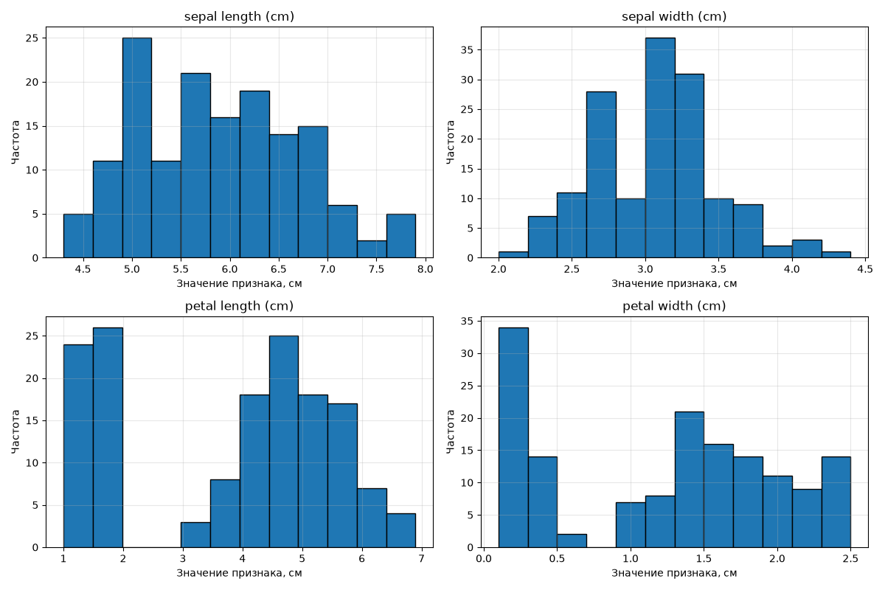

Признаки чашелистиков близки к нормальным, а признаки лепестков — нет (многомодальные распределения, т.к. в данных смешаны три вида ириса).

### 5. Выводы по первому этапу

- **Однородность:** данные однородны (единый масштаб, нет выбивающихся порядков величин).
- **Сила зависимости:** сильная — лепестки связаны почти идеально (r ≈ 0.96).
- **Распределение:** чашелистики ~ нормальные, лепестки — нет.
- **Самые информативные признаки** для предсказания ширины лепестка: **длина лепестка** и **длина чашелистика**.

### 6. Построение регрессии

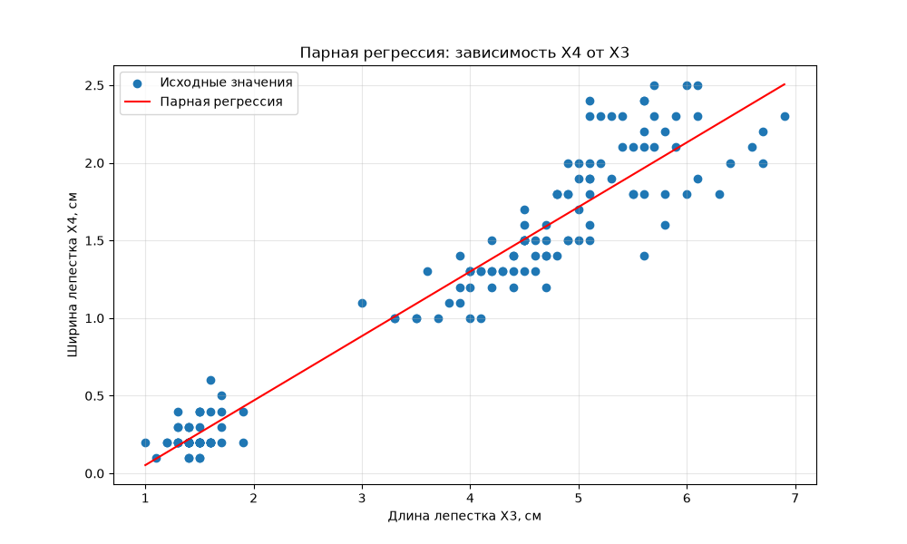

Парная (ширина лепестка ~ длина лепестка) и множественная (ширина лепестка ~ длина лепестка + длина чашелистика + ширина чашелистика) регрессии.

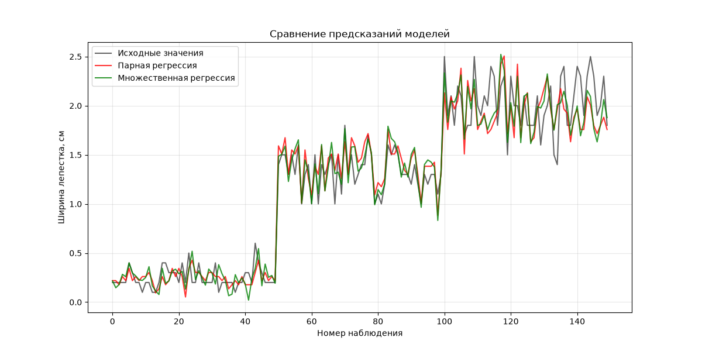

| | Парная регрессия | Множественная регрессия |
|---|---|---|
| R | 0.9629 | 0.9684 |
| R² | 0.9271 | **0.9379** |
| Скорр. R² | 0.9266 | **0.9366** |
| Стандартная ошибка | 0.2065 | **0.1920** |

**Наиболее адекватная модель — множественная регрессия.** Она имеет немного выше R²/скорр. R² и заметно ниже стандартную ошибку. Прирост небольшой, потому что один признак (длина лепестка) уже объясняет почти всё.

### 7. Нормальность остатков и автокорреляция

Остатки = разница между настоящим и предсказанным значением. Если остатки распределены нормально и не автокоррелированы, модель адекватна.

| Модель | D (KS) | p-value | Нормальность | DW | Вывод по DW |
|---|---|---|---|---|---|
| Парная | 0.0651 | 0.5267 | нормальные | 2.21 | автокорреляции нет |
| Множественная | 0.0625 | 0.5787 | нормальные | 2.01 | автокорреляции нет |

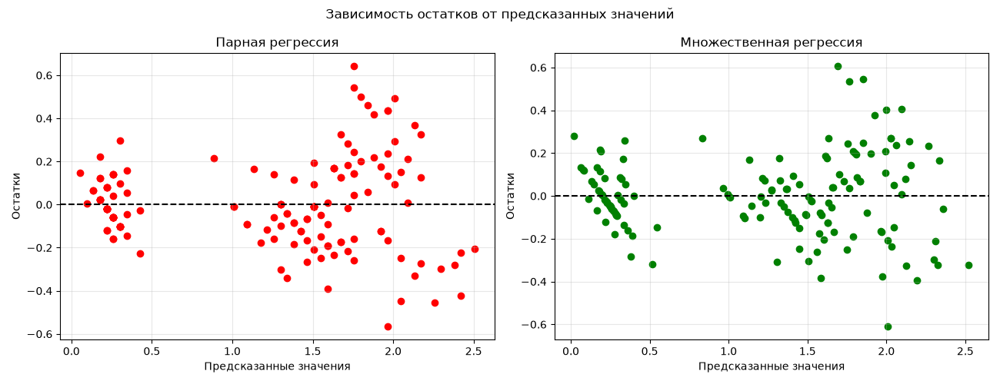

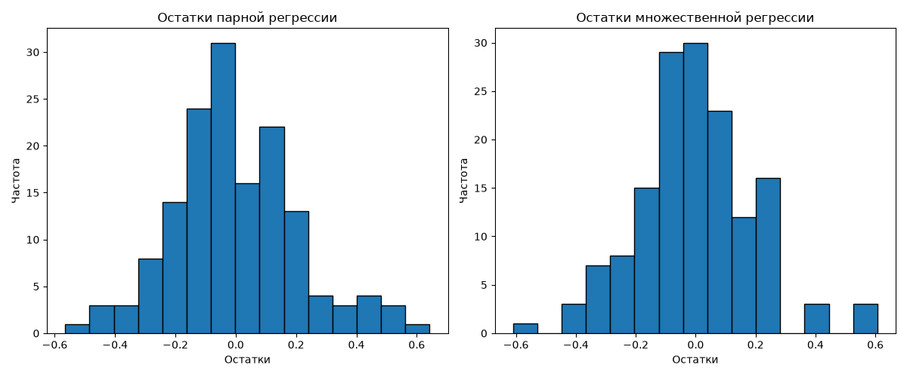

Остатки обеих моделей распределены нормально (p ≫ 0.05) и не имеют систематической структуры (DW ≈ 2). **Модель адекватна.**

### 8. Анализ выбросов (boxplot + метод межквартильного размаха)

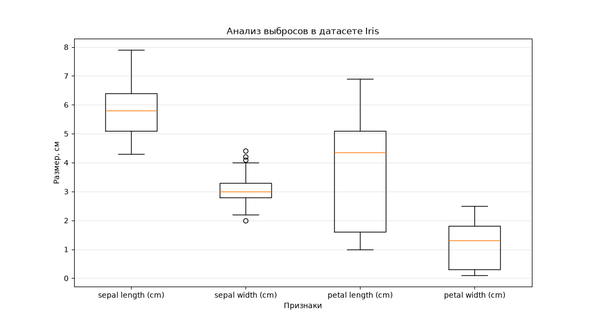

| Признак | Количество выбросов |
|---|---|
| sepal length | 0 |
| sepal width | 4 |
| petal length | 0 |
| petal width | 0 |

Выбросы есть только в ширине чашелистика (4 точки). Они не портят модель — её качество высокое и стабильное.

### 9. Предсказание и анализ ошибок

Деление на обучение (75%) и тест (25%). Модель обучают на части данных и проверяют на «невиданных».

| Метрика | Значение |
|---|---|
| MSE | 0.0405 |
| RMSE (СКО) | **0.2012 см** |
| R² | **0.9369** |

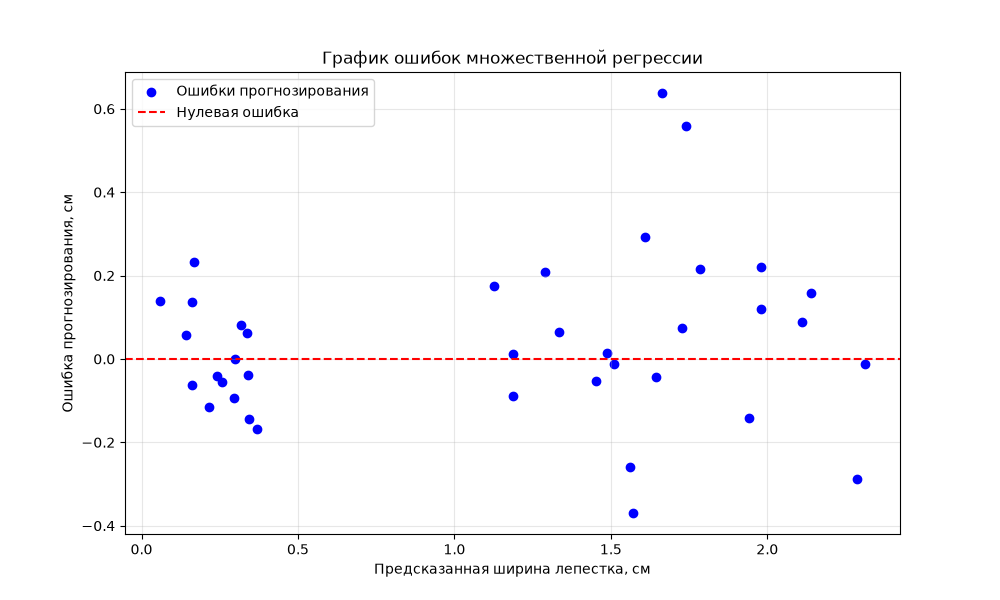

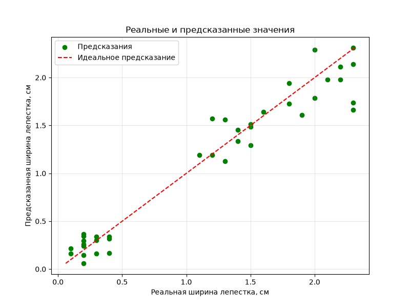

Mодель предсказывает ширину лепестка с точностью ~0.2 см — это отличные результаты для биологических данных.

### 10. Рекомендации

Добавить признак «вид ириса» (категориальный), учесть немодальные распределения лепестков, проверить влияние 4 выбросов ширины чашелистика.

---

## Датасет 2. Рост – Вес – Возраст – Позиция (бейсболисты)

**Что это:** 115 игроков. Признаки: `Position` (позиция, кодируется числами 101–105 — фактически категориальный признак), `Height` (рост, дюймы), `Weight` (вес, фунты), `Age` (возраст). Целевая переменная — **`Weight` (вес)**.

### 1. Диаграмма Тьюки и размах

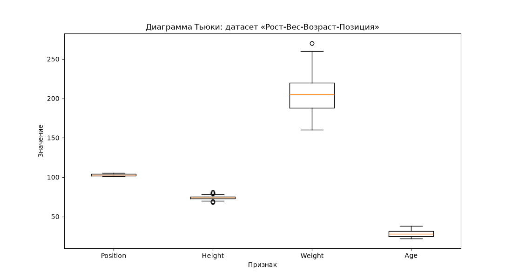

Вес разбросан широко (188–268 фунтов), рост — узко (69–78 дюймов), возраст (25–41). Позиция — дискретная шкала 101–105.

### 2. Парные корреляции

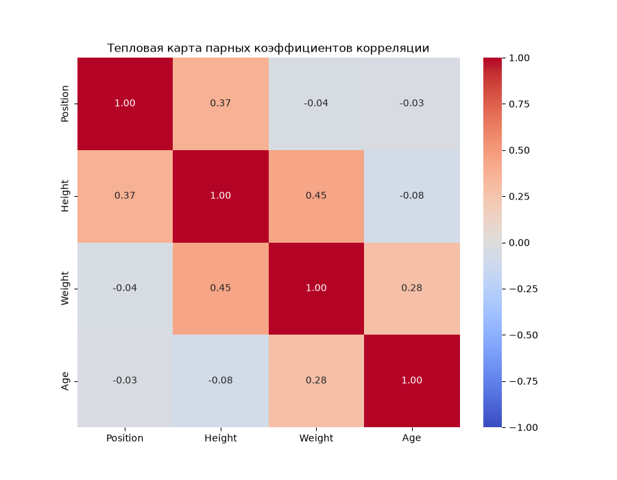

Самая сильная связь — **рост и вес** (высокие обычно тяжелее). Возраст и позиция связаны со слабее.

### 3. Частные корреляции

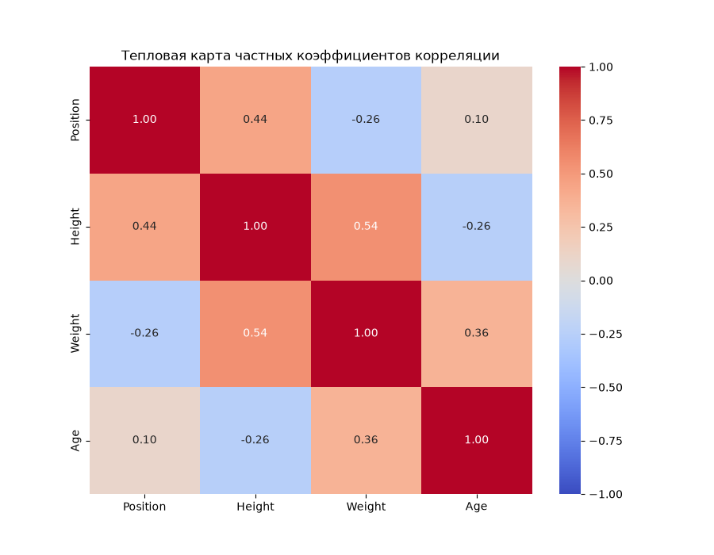

После вычитания влияния остальных признаков связь рост–вес остаётся основной; влияние позиции и возраста — вспомогательное.

### 4. Нормальность признаков (Критерий К–С)

| Признак | D | p-value | Вывод |
|---|---|---|---|
| Position | 0.5667 | 0.0000 | ненормальный |
| Height | 0.1493 | 0.0000 | ненормальный |
| Weight | 0.0900 | 0.0434 | ненормальный |
| Age | 0.0505 | 0.4962 | нормальный |

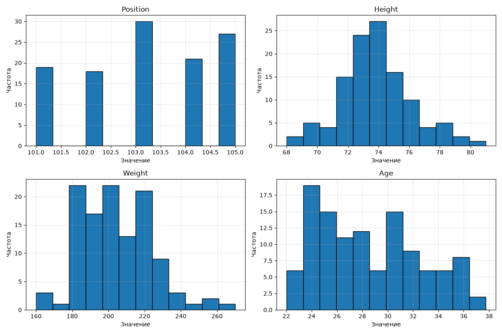

Большинство признаков не нормальные (что типично для реальных антропометрических данных), возраст — почти нормальный.

### 5. Выводы по первому этапу

- **Однородность:** в целом однородно, но вес сильно разбросан; позиция — категориальный признак, кодированный числами.
- **Сила зависимости:** средняя — рост объясняет заметную часть веса, но не всё (разные телосложения).
- **Самый информативный признак:** **рост**, затем возраст и позиция.

### 6. Построение регрессии

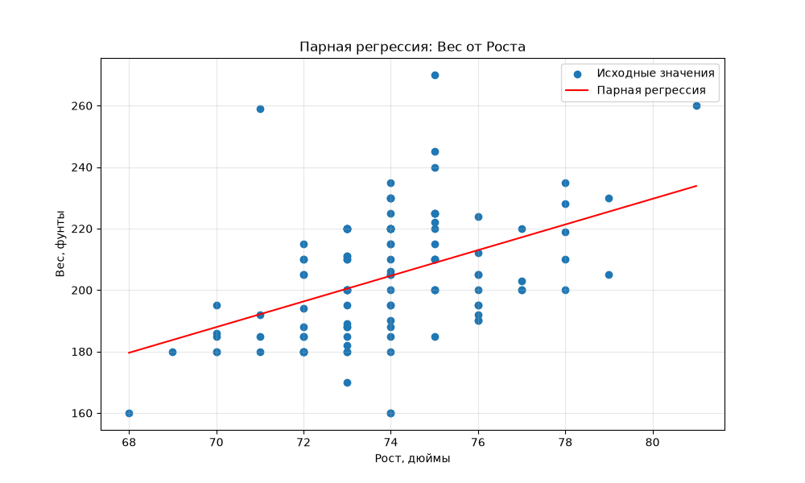

```
Парная:        Weight = -104.24 + 4.17 * Height
Множественная: Weight = 131.18 + 5.25*Height + 1.55*Age - 3.48*Position
```

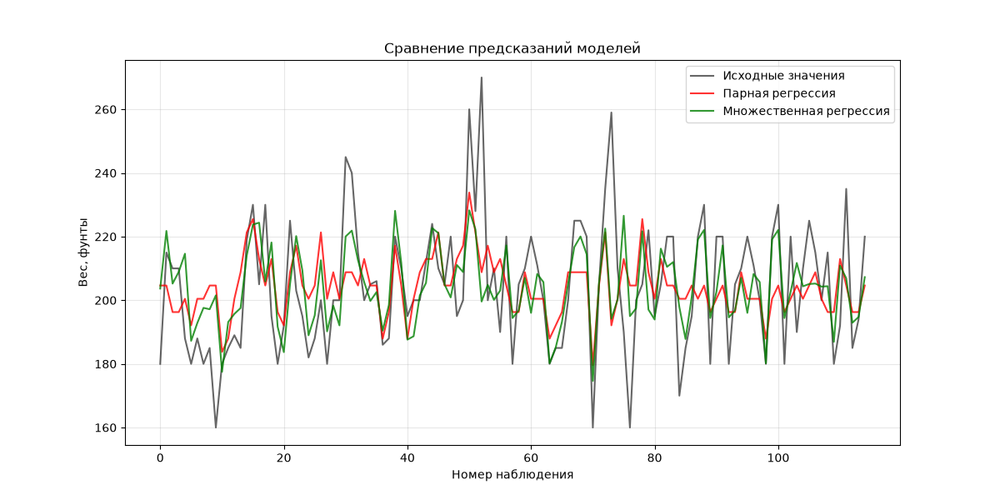

| | Парная регрессия | Множественная регрессия |
|---|---|---|
| R | 0.4451 | 0.5886 |
| R² | 0.1981 | **0.3465** |
| Скорр. R² | 0.1910 | **0.3288** |
| Стандартная ошибка | 18.20 | **16.58** |

**Наиболее адекватная модель — множественная регрессия** (в 1.75 раза выше R², ниже ошибка). В отличие от Iris здесь прирост от добавления признаков значимый — рост один сам по себе объясняет вес плохо.

### 7. Нормальность остатков и автокорреляция

| Модель | D (KS) | p-value | Нормальность | DW | Вывод по DW |
|---|---|---|---|---|---|
| Парная | 0.0779 | 0.4647 | нормальные | 1.75 | возможна слабая положительная |
| Множественная | 0.1073 | 0.1315 | нормальные | 1.91 | автокорреляции нет |

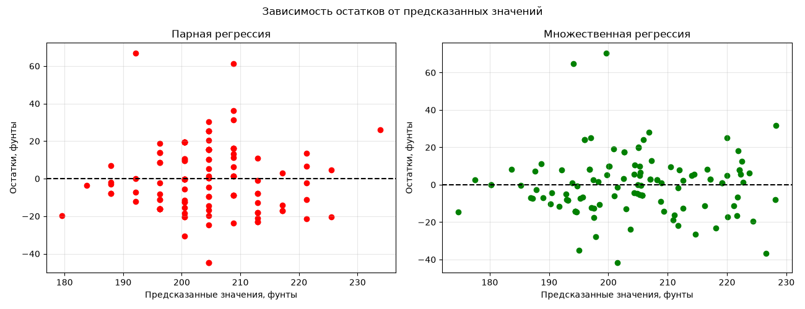

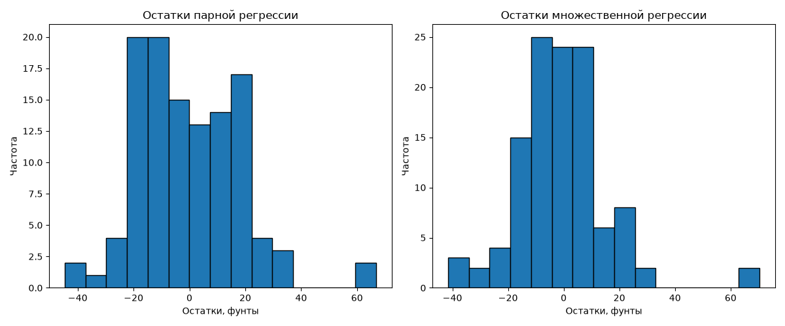

Остатки распределены нормально, автокорреляция не выражена. Модель пригодна, хотя качество умеренное (R² ≈ 0.35).

### 8. Анализ выбросов

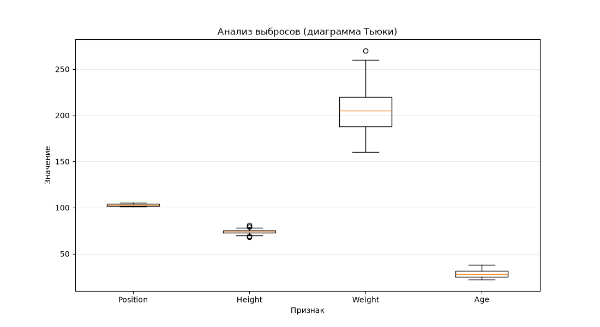

| Признак | Количество выбросов |
|---|---|
| Position | 0 |
| Height | 5 |
| Weight | 1 |
| Age | 0 |

### 9. Предсказание и анализ ошибок

| Метрика | Значение |
|---|---|
| MSE | 209.7 |
| RMSE (СКО) | **14.48 фунтов** |
| R² | **0.4596** |

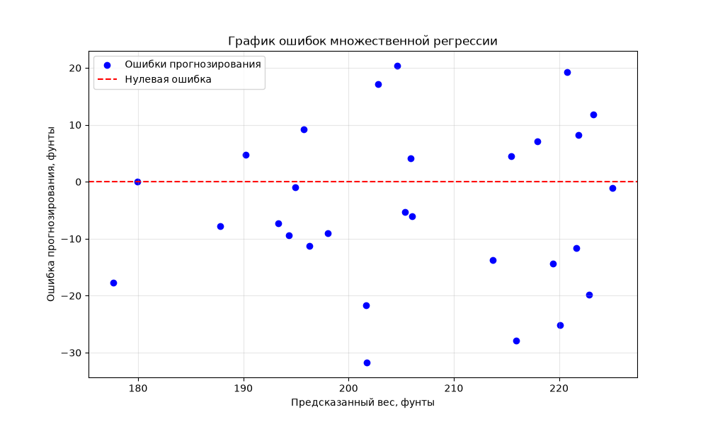

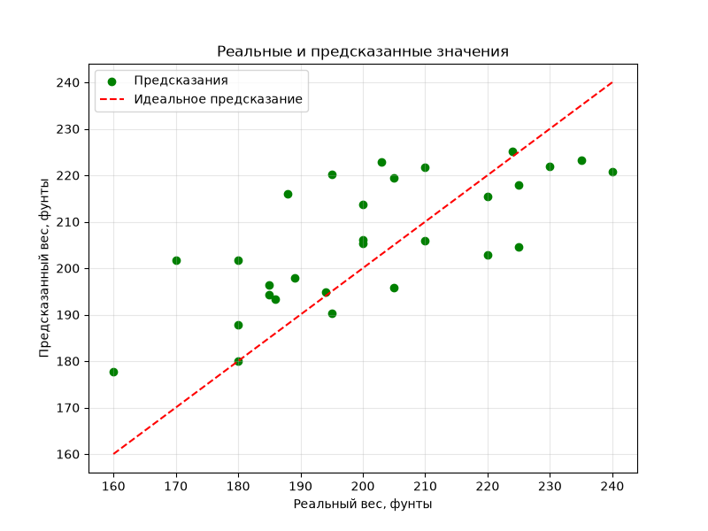

Mодель предсказывает вес с точностью ~14.5 фунтов. Это скромнее, чем у Iris, — вес человека сложнее предсказать по паре-тройке признаков.

### 10. Исследование влияния выбросов (как и почему меняется регрессия)

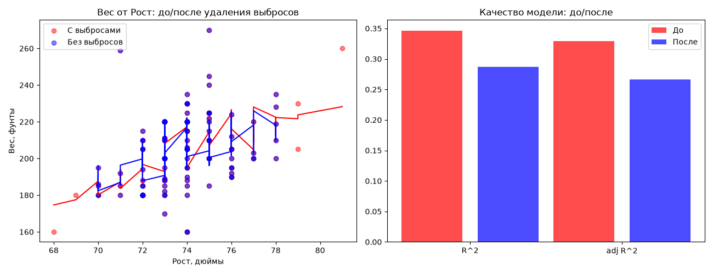

Построили ту же множественную регрессию **до и после** удаления строк, чьи значения попадают за границы межквартильного размаха (всего удалено **5 из 115** строк — это в основном крайние значения роста: 69, 72, 79, 81 дюйм).

| | R² | Скорр. R² | b0 | Height | Age | Position |
|---|---|---|---|---|---|---|
| **До** (все данные) | 0.3465 | 0.3288 | 131.18 | 5.252 | 1.548 | −3.483 |
| **После** (без выбросов) | 0.2867 | 0.2665 | 171.22 | 4.559 | 1.594 | −3.389 |

**Как меняется:** R² и скорректированное R² **уменьшились** (0.3465 → 0.2867). Свободный член сдвинулся (131 → 171), коэффициент при росте снизился (5.25 → 4.56), остальные почти не изменились.

**Почему так произошло.** Обычно «убрать выбросы = улучшить модель», но здесь выбросы — это **реальные** высокие и низкие росты, которые лежат **на** тренде «чем выше — тем тяжелее». Они расширяют диапазон роста и тем самым помогают прямой линии «объяснить» больше разброса веса. Убрав их:

1. **Уменьшился разброс роста** — линейной модели стало «не на что опереться», объяснённая дисперсия упала.
2. **Сократилась выборка** (115 → 110), при маленьком n это заметно бьёт по R².
3. Остаточная (необъяснённая) часть стала больше по отношению к общей, поэтому доля, объяснённая моделью, снизилась.

**Вывод:** метод IQR — это эвристика для поиска подозрительных точек, а не автоматический инструмент очистки. В данном случае «выбросы» не искажают модель, а поддерживают её, поэтому их удаление **ухудшило** качество. Это хороший пример того, что надо смотреть на результат, а не удалять точки «на автомате».

### 11. Рекомендации

- Разметить реальные позиции игроков (категориальные переменные + фиктивные показатели), потому что числа 101–105 не имеют линейного смысла.
- Уточнить вес по мышечной массе и телосложению — это сильнее объяснит вес, чем возраст и позиция.
- Использовать нелинейные модели (полиномиальная регрессия, градиентный бустинг) для роста связной связи.

---

## Датасет 3. Корреляционный анализ (Barotrop, Chemical_process, Factor)

Здесь **не строится регрессия** — задача определить **насколько** признаки связаны и **можно ли** по этим данным строить регрессионные модели.

### Barotrop.csv (37 строк × 2 признака: LONGITUD, LATITUDE)

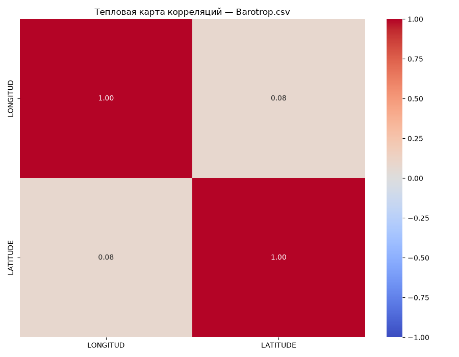

| Пара | r |
|---|---|
| LONGITUD ↔ LATITUDE | **0.081** |

Связь практически отсутствует (|r| < 0.1). **Регрессионную модель строить нецелесообразно** — координаты не зависят друг от друга.

### Chemical_process.csv (100 строк × 5 признаков: YIELD, HCL, NH3, H20, CATALYST)

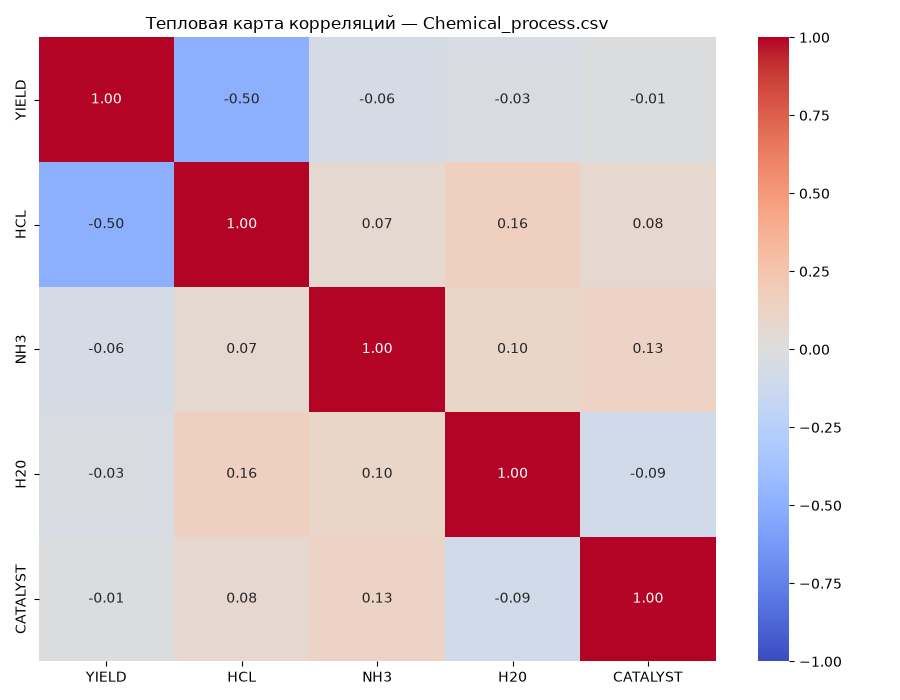

Самые сильные пары:

| Пара | r |
|---|---|
| YIELD ↔ HCL | **−0.504** |
| HCL ↔ H20 | 0.161 |
| NH3 ↔ CATALYST | 0.131 |
| NH3 ↔ H20 | 0.103 |

Есть одна **умеренная** связь (доля выхода и концентрация HCL, r ≈ −0.5), остальные связи слабые (|r| < 0.2). **Регрессионную модель строить можно, но она будет средней точности**; целевая переменная `YIELD` лучше всего объясняется признаком `HCL`, остальные — вспомогательные.

### Factor.csv (100 строк × 10 факторов)

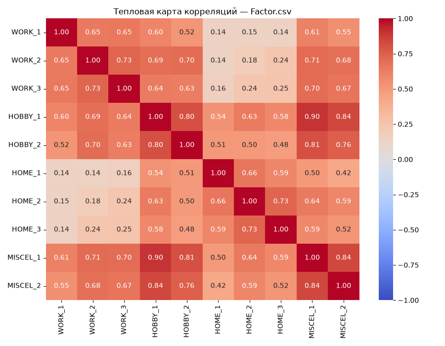

Самые сильные пары:

| Пара | r |
|---|---|
| HOBBY_1 ↔ MISCEL_1 | **0.904** |
| HOBBY_1 ↔ MISCEL_2 | 0.843 |
| MISCEL_1 ↔ MISCEL_2 | 0.841 |
| HOBBY_2 ↔ MISCEL_1 | 0.811 |

Здесь **много очень сильных корреляций** (r > 0.8 между разными парами). **Регрессию строить можно и она будет хорошей**, но есть проблема **мультиколлинеарности** — предикторы сами сильно связаны между собой, из-за чего коэффициенты модели становятся нестабильными. Нужно либо убрать лишние признаки, либо использовать регуляризацию (Ridge/Lasso), либо методы снижения размерности (PCA).

---

## Итоги по всем датасетам

| Датасет | Связь | Модель | R² (на тесте) | RMSE | Можно ли регрессию |
|---|---|---|---|---|---|
| Iris | сильная (r≈0.96) | множественная | 0.937 | 0.20 см | Да, хорошо |
| Бейсболисты | средняя (rост–вес) | множественная | 0.346 (R² тест 0.460) | 14.5 фунтов | Да, средняя точность |
| Barotrop | почти нет (0.08) | — | — | — | Нет |
| Chemical_process | умеренная (YIELD–HCL −0.5) | — | — | — | Осторожно |
| Factor | много сильных (r>0.8) | — | — | — | Да, но с мультиколлинеарностью |

---

## Структура файлов

```
LR1/
├── README.md                     ← этот отчёт
├── Iris.py                       ← скрипт датасета 1 (Iris)
├── HW.py                         ← скрипт датасета 2 (бейсболисты)
├── Additional.py                 ← скрипт датасета 3 (корреляционный анализ)
├── datasets/
│   ├── iris/                     ← исходный xlsx датасета Iris
│   ├── baseball/                 ← исходный xlsx бейсбола
│   └── csv/                      ← 5 CSV (Irisdat, Рост–Вес…, Barotrop, Chemical_process, Factor)
├── notebooks/
│   ├── Iris.ipynb                ← ноутбук датасета 1
│   ├── HW.ipynb                  ← ноутбук датасета 2
│   └── Additional.ipynb          ← ноутбук датасета 3
└── pics/                         ← 26 графиков (1_*, 2_*, corr_*)
```

Чтобы воспроизвести все картинки:

```bash
pip install pandas numpy matplotlib seaborn scipy scikit-learn pingouin
python Iris.py
python HW.py
python Additional.py
```